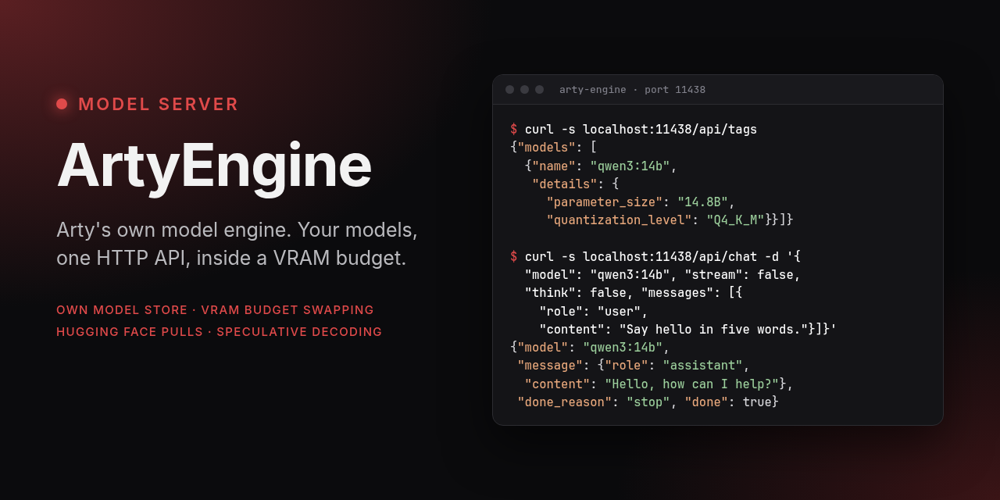

<div align="center">



# ArtyEngine

**Arty's own model engine. It serves models from its own store, keeps them inside a VRAM budget, pulls new ones
from Hugging Face and runs speculative decoding, behind one HTTP API.**

[](https://www.python.org/)
[](#install)
[](LICENSE)

</div>

---

## Contents

- [What it is](#what-it-is)
- [Requirements](#requirements)
- [Install](#install) (quick start)
- [Configuration](#configuration)
- [The engine's HTTP API](#the-engines-http-api)
- [Stores in the older layout](#stores-in-the-older-layout)
- [AMD GPUs (untested)](#amd-gpus-untested)
- [How Arty uses it](#how-arty-uses-it)
- [Development](#development) and [License](#license)

| Page | What is in it |
|---|---|
| [docs/install.md](docs/install.md) | The full install, running in a terminal, upgrading from before 14 Nov 2026 |
| [docs/configuration.md](docs/configuration.md) | Every `engine.json` key, the shipped config, how the GPU backend is chosen |
| [docs/api.md](docs/api.md) | Every endpoint, unreadable models, leaked thinking, pulls and `source` |
| [docs/security.md](docs/security.md) | Loopback, `Origin` and `Host` checks, proxies |
| [docs/store-migration.md](docs/store-migration.md) | Converting and undoing a store in the older layout, unused blobs |
| [docs/amd.md](docs/amd.md) | AMD setup: ROCm, Vulkan, supported cards, container devices |
| [docs/amd-check.md](docs/amd-check.md) | The check to run on a machine with an AMD card |
| [docs/arty-integration.md](docs/arty-integration.md) | `arty-backend.sh`, `site.env`, the drop-ins Arty uses |
| [docs/bench.md](docs/bench.md) | The bench helpers and `bench/bench.py` |

---

## What it is

Arty is a self-hosted assistant. ArtyEngine is the server its brain, its tool hub and its web chat send every model
request to, through the engine's HTTP API (`/api/chat`, `/api/generate`, `/api/embed` and the rest, listed in
[docs/api.md](docs/api.md)).

**Who it is for.** People who run Arty, and noncommercial self-hosters who want a model server for one GPU that is
Python standard library only (see [License](#license)).

**Version.** 0.1.0, as `GET /api/version` reports it. There are no tagged releases yet.

- **Its own model store.** Every model has one manifest in the store's `catalog` folder, naming its weights and
  extras (projector, template, parameters, system prompt, license) by sha256; the files themselves sit once each in
  `blobs`. Models keep short names such as `qwen3:14b`, and pulled ones are named after their Hugging Face repository.
- **One runtime process per model.** For each loaded model the engine starts a prebuilt model runtime (see
  [NOTICE](NOTICE)) on a local port, so a crash takes down one model, not the server. The runtime is downloaded
  separately and never copied into this repository.
- **VRAM budget swapping.** Before a model loads, the engine estimates what it needs (weights, KV cache, overhead)
  and unloads the least recently used idle models until it fits `vram_budget_mb` and the card's free memory.
  A model loaded on the CPU (`num_gpu: 0`) needs none of it, so it never unloads or waits for another model.
  `keep_alive` says how long a model stays loaded.
- **Hugging Face pulls.** `hf.co/<owner>/<repo>:<quant>` picks the matching GGUF (and a vision projector when the
  repository has one, F16 first), checks its sha256, resumes partial downloads and keeps to a bandwidth cap. Short names such
  as `qwen3:14b` or `nomic-embed-text` are pulled from the Hugging Face repository `arty_engine/short_names.json`
  lists for them and keep the short name. Pulled models go into the engine's own store. Hugging Face is the only
  source.
- **Speculative decoding.** Per model: a small draft model or n-gram speculation (`spec_type`, for example
  `ngram-mod`), which needs no draft model at all.
- **Answers the way Arty expects.** Thinking comes back as `message.thinking`, tool call arguments come back as
  objects, tool definitions are written into the prompt compactly, and `/api/generate` with an empty prompt loads or
  unloads a model.
- **Optional trainer hand-off.** With `trainer_url` set, the engine tells a GPU-sharing controller `/busy` before a
  request and `/done` after it, so something else (such as a training job) can use the card while the engine is idle.

The engine is Python standard library only. It reads the card's free memory with `nvidia-smi` on an NVIDIA card, and
with `amd-smi`, `rocm-smi` or the amdgpu driver's own files on an AMD card ([untested](#amd-gpus-untested)).

---

## Requirements

- **Linux with an NVIDIA GPU**, with `nvidia-smi` on the `PATH`. Built and tested on an RTX 3060 (12 GB) in a Debian 13
  container. AMD cards have a code path that has never run on a real AMD card; see [AMD GPUs (untested)](#amd-gpus-untested).
- **Python 3.10 or newer.** No packages to install. The tests need `pytest`.
- **The model runtime**, a prebuilt release for your GPU (see [Install](#install)). If the CUDA runtime libraries it
  needs (`libcudart`, `libcublas`) are not on the system, put them in a folder and list it in `library_path`.

---

## Install

The defaults expect everything under `/srv/ai/arty-engine`, with the models in `/srv/ai/arty-engine/models`, the
layout Arty uses. Any other folders work; set them in the config. The full walk-through is in
[docs/install.md](docs/install.md).

1. Copy this repository to `/srv/ai/arty-engine/src`.
2. Download the runtime's official CUDA build from https://github.com/ggml-org/llama.cpp/releases (tested with release
   b12110 for CUDA 12.8), unpack it under `/srv/ai/arty-engine/runtime/`, and link `/srv/ai/arty-engine/runtime/server`
   to its model server binary.
3. Copy `deploy/engine.json` to `/srv/ai/arty-engine/engine.json` and set at least `vram_budget_mb` to a little under
   your card's memory.
4. Install `deploy/arty-engine.service`, then check the engine answers:

```bash
sudo systemctl enable --now arty-engine
curl -s localhost:11438/api/version
curl -s localhost:11438/api/tags
```

The engine listens on `127.0.0.1:11438` and has no authentication of its own. Keep it on loopback, or put a reverse
proxy with authentication in front of it; see [docs/security.md](docs/security.md).

Upgrading an install from before 14 Nov 2026: [docs/install.md](docs/install.md#upgrading-an-install-from-before-14-nov-2026).

---

## Configuration

`engine.json` is a JSON object. Every key is optional; an unknown key stops the engine with an error. Start with
`vram_budget_mb`. All keys, their defaults, the shipped config and how `gpu_backend` `auto` chooses are in
[docs/configuration.md](docs/configuration.md).

---

## The engine's HTTP API

| Endpoint | In the engine |
|---|---|
| `GET /api/version`, `GET /api/tags`, `GET /api/ps` | Version, models in the store, loaded models with context and VRAM |
| `POST /api/chat`, `POST /api/generate` | Streamed or not; tools, `think`, `format`, images, `keep_alive`, `num_ctx`, `num_gpu: 0` |
| `POST /api/embed`, `POST /api/embeddings` | Embeddings |
| `POST /api/show`, `POST /api/pull`, `DELETE /api/delete` | Model details; Hugging Face pulls; deletes from the engine's own store |
| `POST /api/create`, `/api/copy`, `/api/push` | **501** |

Every answer carries `Server: arty-engine/<version>`. All endpoints, the cases that answer 501, 404 or 409, how leaked
thinking is handled and how pulls work are in [docs/api.md](docs/api.md).

---

## Stores in the older layout

Earlier versions kept manifests in `manifests` and `manifests-v2` folders beside `blobs`. The engine no longer reads
those; `tools/migrate_store.py` converts such a store in place, with the engine stopped:

```bash
python3 tools/migrate_store.py plan --store /srv/ai/arty-engine/models
python3 tools/migrate_store.py migrate --store /srv/ai/arty-engine/models --backup /srv/ai/arty-engine/store-layout-backup
python3 tools/migrate_store.py undo --store /srv/ai/arty-engine/models --backup /srv/ai/arty-engine/store-layout-backup
```

What each command does, its refusals, and `tools/unused_blobs.py` are in [docs/store-migration.md](docs/store-migration.md).

---

## AMD GPUs (untested)

**No real AMD run has been done.** The AMD path is written and tested only against fakes on machines without an AMD
card. Treat it as a starting point; `tools/amd-check.sh` ([docs/amd-check.md](docs/amd-check.md)) checks it on a
machine that has one. The setup, supported cards and container devices are in [docs/amd.md](docs/amd.md).

**Which runtime build.** Two official release builds of the same runtime as the CUDA one (release b12110, the one the
engine was tested with), each unpacked into a folder of its own:

- ROCm: https://github.com/ggml-org/llama.cpp/releases/download/b12110/llama-b12110-bin-ubuntu-rocm-10.0-x64.tar.gz
- Vulkan: https://github.com/ggml-org/llama.cpp/releases/download/b12110/llama-b12110-bin-ubuntu-vulkan-x64.tar.gz

Their published sha256 digests are `664b5c218ec9a38d1e7b543bae7407dc62a4051ba09ddc51bd29f68ee77da674` (ROCm) and
`a5d741940956ec62e8783aee7e5a4c7c761af867d6f027c3277a51e1a3ac59b0` (Vulkan).

The build carries GPU code for gfx908, gfx90a, gfx942, gfx950, gfx1010 to gfx1012,
gfx1030 to gfx1036, gfx1100 to gfx1103, gfx1150 to gfx1152, gfx1200 and gfx1201.

---

## How Arty uses it

Arty's brain, its tool hub and its web chat send their model requests to `ARTY_ENGINE_URL`
(`http://127.0.0.1:11438`). On a Proxmox install, `tools/host/arty-backend.sh` sets this up from the host. The drop-ins,
the `site.env` settings and the bench helpers are in [docs/arty-integration.md](docs/arty-integration.md) and
[docs/bench.md](docs/bench.md).

---

## Development

```bash
python3 -m pytest -q tests
```

The tests run without a GPU or models: they build small GGUF files and fake stores, start a fake model runtime, and
replay answers recorded from real runs (`tests/fixtures/`).

---

## License

[PolyForm Strict 1.0.0](LICENSE). In short: you may use the engine for any noncommercial purpose (personal use,
research, hobby projects, and use by charities, schools, public research and government bodies), but you may not
distribute it or make changes or new works based on it. It comes as is, without warranty. See [NOTICE](NOTICE) for
the model runtime the engine starts, which is MIT licensed.
